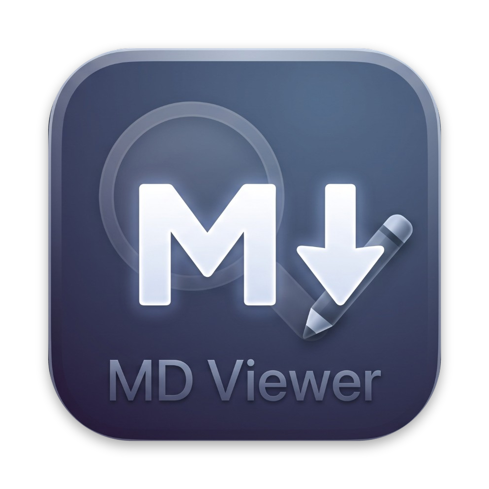

<p align="center">
  
</p>

# MD Viewer

A small, native Markdown viewer and editor for macOS, written in Swift and SwiftUI.

It is a **viewer first**: opening a `.md` file from Finder shows it fully rendered. The editor is one click away when you want to change something.

## Features

- **Viewer first.** Existing files open rendered in a centred reading column. New documents (⌘N) start with the editor open.
- **Split editor.** Toggle the editor from the toolbar or **View ▸ Edit Markdown** (⌥⌘E). A native, draggable `HSplitView` divider sits between the editor and the preview.
- **Selectable preview.** Preview text uses `.textSelection(.enabled)`, so you can select and copy it and use macOS Look Up and the other text services.
- **Light and Dark Mode.** Colours come from system colours such as `Color(nsColor: .textBackgroundColor)`, with no hardcoded hex values.
- **Native file handling.** Built on `DocumentGroup`, so you get the standard Open, Save and Save As panels, recent documents, autosave and the edited indicator.
- **TextEdit-style launch.** Opening the app on its own shows an Open dialog with a **New Document** button. Opening a file from Finder skips the dialog.

### Supported Markdown

Headings (ATX and setext), paragraphs, bold, italic, strikethrough, inline code, links, ordered, bulleted and nested lists, task lists, block quotes, fenced code blocks, horizontal rules, and tables with column alignment.

### Math (LaTeX)

- Inline: `$E = mc^2$` and `\(…\)`
- Display: `$$…$$`, `\[…\]`, or a ```` ```math ```` fence
- Typeset natively with [SwiftMath](https://github.com/mgriebling/SwiftMath). It follows Light and Dark Mode.
- Common KaTeX spellings (`align`, `array`, `\dfrac`, `\operatorname`, `\implies`, `\boldsymbol`, …) are translated to forms SwiftMath understands. Unsupported input, such as `\underbrace`, `\xrightarrow` or `\href`, is shown as red source text.
- Formulas are images, so selecting one does not copy its LaTeX. Right-click a display equation and choose **Copy LaTeX**.

### Diagrams (Mermaid)

- ```` ```mermaid ```` fences render as diagrams using a bundled copy of [Mermaid](https://mermaid.js.org) 11.17.2, so they work offline.
- Each diagram is a transparent `WKWebView` that follows Light and Dark Mode.
- Syntax errors show Mermaid's message in red.
- Text inside a diagram is selected by the web view rather than SwiftUI.

## Requirements

- macOS 15 or later
- Swift 5.9+ toolchain (Xcode or the Command Line Tools)
- Network access on the first build, to fetch SwiftMath

## Build and run

```bash
./scripts/bundle.sh
```

```bash
open "build/MD Viewer.app"
```

`bundle.sh` runs `swift build -c release`, assembles `build/MD Viewer.app`, copies in the resource bundles and icon, and ad-hoc signs it. Pass `debug` to build a debug configuration.

Use the bundled app rather than `swift run`: the Markdown file type is declared in `Support/Info.plist`, which only takes effect inside an app bundle.

To open files with it from Finder, right-click a `.md` file and choose **Open With ▸ MD Viewer**.

## Project layout

| Path | Purpose |
| --- | --- |
| `Sources/MDViewer/MDViewerApp.swift` | App entry, `DocumentGroup`, menu commands, launch Open dialog |
| `Sources/MDViewer/ContentView.swift` | Editor and preview split view |
| `Sources/MDViewer/MarkdownDocument.swift` | `FileDocument` for `.md` files and the welcome text |
| `Sources/MDViewer/MarkdownParser.swift` | Block-level Markdown parser |
| `Sources/MDViewer/MarkdownPreview.swift` | SwiftUI rendering of parsed blocks |
| `Sources/MDViewer/MarkdownMath.swift`, `MathRenderer.swift` | LaTeX detection and typesetting |
| `Sources/MDViewer/MermaidView.swift`, `MermaidAssets/` | Mermaid web view and bundled `mermaid.min.js` |
| `Support/` | `Info.plist` and app icon |
| `scripts/bundle.sh` | Builds the `.app` bundle |

## Notes

- Inline Markdown (bold, links, code spans) is resolved with Foundation's `AttributedString(markdown:)`.
- Not supported: images, raw HTML, indented code blocks.
- The bundle identifier in `Info.plist` is a placeholder (`com.example.MDViewer`). Change it before distributing the app.

## Licences

Mermaid is MIT licensed; its licence is in `Sources/MDViewer/MermaidAssets/LICENSE-mermaid.txt`. SwiftMath is MIT licensed and its bundled math fonts carry their own licences.
